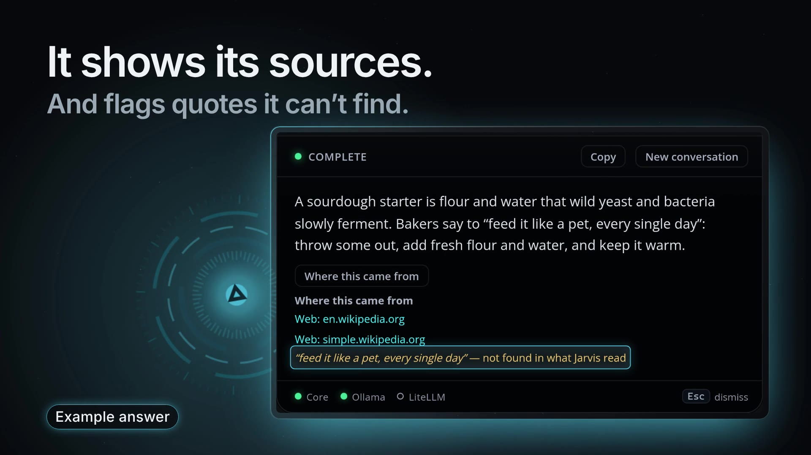

# Epic-Jarvis

**A local-first personal AI assistant for one person: your Windows 11 PC and your Android phone.**

Everything private stays on your own machine. The everyday model runs on your graphics card, your memory and files stay in your own folders, and the phone reaches the PC only over a private device-to-device network.

**Who this is for, and what it is not:** This is **one person's assistant**, built for one owner and one household PC. It is not a product you roll out to a team, not a cloud service, and not something that runs on a server you rent. Install it on your own Windows 11 machine, pair your own phone, and use it. It is **non-commercial**: the app is sideloaded on the phone, never listed on Google Play, and what it learns is never sold, shared or sent anywhere you did not name.

It is also **working software with honest gaps**, not a finished product. Section 8 of this page, [Honest limits](#honest-limits), lists what does not work yet; the project reads that list as part of the product.

## Contents

1. [What Jarvis is](#what-jarvis-is)
2. [What you can do today](#what-you-can-do-today)
3. [Quick start](#quick-start)
4. [The five rules that are not negotiable](#the-five-rules-that-are-not-negotiable)
5. [What asks first](#what-asks-first)
6. [What's new](#whats-new)
7. [Feature highlights](#feature-highlights)
8. [Honest limits](#honest-limits)
9. [Repository structure](#repository-structure)
10. [Where to read next](#where-to-read-next)
11. [License and credits](#license-and-credits)

## What Jarvis is

Jarvis is three programs that talk to each other on your own network.

- **The backend** is a Python program on your Windows 11 PC. It holds your memory, decides what needs your permission, and talks to a local model through [Ollama](https://ollama.com/). It is the only part that touches your files, your email and your accounts - and the desktop app can start it for you, so once it is set up there is no terminal window to keep open.
- **The desktop app** is the face on the PC: a small always-ready bar (press `Alt+Space`) for quick questions, and a larger window with three looks, seven starting layouts you can pick in Settings, focus presets, the approval cards, the capability and memory Galaxy, and the telemetry. It is a Windows app built with Tauri, Rust and WebView2.
- **The Android app** is the companion on your phone, over **Tailscale** or **NordVPN Meshnet** (two private device-to-device networks - never a public tunnel). It can chat, answer approval cards, show your memory lists, run Jarvis Live, and back up its own settings.

Everything that touches private material - email, files, credentials, stored memory - is answered by the **model on your PC**. A cloud model can be used for a turn you allow, inside a monthly spending cap, but it never sees the private material.



*A frame from the launch video. Watch it: [Jarvis launch video v6](https://github.com/darknight11ish/Epic-Jarvis/releases/download/launch-videos/jarvis-launch-v6.mp4) (26 seconds) - and every earlier version is kept in [videos/](videos/README.md).*

## What you can do today

- **Ask anything, with `Alt+Space`.** A small bar appears over whatever you are doing; type or talk, and the model on your PC answers. The big window shows the same conversation with steps, timing and sources.
- **Pick how the big window looks.** Three layouts - **Command Cockpit**, **Studio Split-Workspace** and **Ambient Voice Core** - switched by the layout pill in the window's own header, or in Settings. Choose a focus preset (one approval card) or send a single untainted question to the **Cloud** lane.
- **Answer approval cards from wherever you are.** The bar, the desktop widget, the big window and the phone all show the same card, and all can answer it. The riskiest ones need Windows Hello on the PC or your screen lock on the phone. Cards that replace or delete data take **two presses**. Undo puts most changes back.
- **A memory that learns from your own words.** Jarvis saves facts about you and your projects automatically (only from what you type or say - never from pages, emails or files), lists every one in both apps with a **Forget** button, and can answer *"what did I believe on this date?"*.
- **Talk to it.** It checks it is **your** voice before it uses the words, keeps a 300 ms cushion in front of a talk-to-type clip, understands spoken number phrases (*"remind me in fifteen minutes"*, *"speak faster"*), and can be woken by name. **Jarvis Live** on the phone gives you a hands-free session; it now says plainly when Android stopped it, instead of blaming you.
- **Your own files and notes.** Search and read your files, work with Obsidian, Logseq and Joplin notes, import a **Notion export** into an Obsidian vault, and organize a vault (off by default, and the first real run is on a copy). The **File Guardian** keeps the bytes of anything Jarvis is about to overwrite on disk, and a restore puts a version back after one of your cards.
- **Your money and your study.** Read bank CSV/Excel files for spending, ask *"did any of my subscriptions go up?"*, run a retirement what-if, and study with flashcards that remember what you are about to forget.
- **Your home, mailbox and calendar, through cards.** Read email, draft or send one, tidy the inbox, read the calendar and Home Assistant - each leaves the PC through its own card that says what will leave.
- **The PC itself.** PC help names each graphics card's memory and state, answers heat and *"why is my PC slow"*, and finds four things that fail silently.
- **The phone's screens.** Chat, approvals, memory lists (the Galaxy as a searchable list, never a canvas map), Jarvis Live, notifications for cards and alarms, and an encrypted backup of the phone's own settings.

Some abilities are **off until you switch them on**, each with its own approval card: app control, browser control, the second card's features, the price and flight radar, background learning by topic, and the vault organizer. They are listed with their limits in [Honest limits](#honest-limits).

## Quick start

These are the shortest steps to a first chat. Each one has a full section in [docs/INSTALL.md](docs/INSTALL.md), which is the walking version - read that when something does not go as written.

1. **Install the programs.** Download [Git](https://git-scm.com/), [Python 3.12](https://www.python.org/downloads/) and [Ollama](https://ollama.com/) on the PC. One line does all three:

   ```powershell
   winget install --id Git.Git -e; winget install --id Python.Python.3.12 -e; winget install --id Ollama.Ollama -e
   ```

   Then close PowerShell and open a new one.

2. **Get this repository.**

   ```powershell
   git clone https://github.com/darknight11ish/Epic-Jarvis.git "$env:USERPROFILE\Epic-Jarvis"; cd "$env:USERPROFILE\Epic-Jarvis"
   ```

3. **Run the one setup script.** It copies the backend into `Documents\jarvis-backend`, sets it up, tells you the model command, installs the desktop app (from the signed published installer, or builds it), starts Jarvis and checks it. It changes only that folder and your own user account:

   ```powershell
   powershell -ExecutionPolicy Bypass -File .\scripts\setup-jarvis.ps1
   ```

4. **Get the model.** The setup script prints this exact line. It downloads about 5 GB into Ollama's own folder, then builds Jarvis's tuned copy:

   ```powershell
   [Environment]::SetEnvironmentVariable('OLLAMA_KV_CACHE_TYPE','q8_0','User'); [Environment]::SetEnvironmentVariable('OLLAMA_KEEP_ALIVE','-1','User'); ollama pull qwen3:8b; ollama create jarvis-primary -f backend\jarvis-primary.Modelfile
   ```

   Then quit Ollama from its tray icon and start it again. (The owner's own PC runs `qwen3.5:9b` instead, a plain pull; once the app is running you can switch between models the PC already has in **Settings → Brain → Model**.)

5. **Check the backend is up.** Open [http://127.0.0.1:4719/](http://127.0.0.1:4719/) in a browser: you should see Jarvis's own page. For a full check of everything at once, run this line (it changes nothing and saves `preflight.txt` on your Desktop):

   ```powershell
   $env:JARVIS_BACKEND = "$env:USERPROFILE\Documents\jarvis-backend"; $env:PYTHONIOENCODING = "utf-8"; py -3 backend\selftest.py --preflight | Tee-Object -FilePath "$env:USERPROFILE\Desktop\preflight.txt"; Write-Host "Saved to $env:USERPROFILE\Desktop\preflight.txt"
   ```

6. **Install the desktop app**, if the setup script did not: download the `.msi` or `-setup.exe` from the [desktop-latest release](https://github.com/darknight11ish/Epic-Jarvis/releases/tag/desktop-latest), or build it from this folder - needs Visual Studio Build Tools with the C++ workload, Rust and Node.js:

   ```powershell
   cd "$env:USERPROFILE\Epic-Jarvis\jarvis-desktop"; npm install; npm run tauri build
   ```

   The installer lands in `jarvis-desktop\src-tauri\target\release\bundle\nsis\`. Windows may say it "protected your PC": click **More info**, then **Run anyway**. Updates after that come from the same signed release (`scripts\update-jarvis.ps1`, or **Settings → Updates**).

7. **Pair the phone.** Install **Tailscale** (or **NordVPN Meshnet**) on the PC and the phone and sign in with the same account. In the desktop app: **Settings → Connection → Let my phone reach this** (type the PC's `100.` address) and save; then the one firewall line in [docs/INSTALL.md](docs/INSTALL.md) section 3.2, and restart Jarvis. Install the APK from the [client-latest release](https://github.com/darknight11ish/Epic-Jarvis/releases/tag/client-latest), open it, and on the pairing screen type the PC's Tailscale name (`yourpc.tailnet.ts.net:4719`) and the token from **Settings → Connection → Show the token for my phone**.

8. **Your first chat.** Press `Alt+Space` (or tray icon → **Show or hide the Jarvis bar**, if another program took that key), type `hello`, and press Enter. An answer means the whole chain works.

9. **For developers - one check line.** From the repository folder, run every backend test suite that can run here (unsetting `JARVIS_BACKEND` first so the runner always stages a throwaway copy and never touches your live folder):

   ```powershell
   Remove-Item Env:JARVIS_BACKEND -ErrorAction SilentlyContinue; python -B backend/run_suites.py
   ```

## The five rules that are not negotiable

These are not features. They are the promises the whole program is built around, and every change is checked against them. They are in the owner's own words, because the exact wording is part of the decision.

1. Anything touching email, files, credentials or stored memory stays on the local model. The app sends none of it anywhere.
2. The app never opens a public tunnel. No ngrok, no Cloudflare Tunnel, no Tailscale Funnel, no "share my Jarvis".
3. API keys are allowed in the app - the owner reversed the old blanket ban on 2026-09-17, to unblock things like a GitHub API integration. Any key still gets the same care the pairing token already gets: never logged, sent only to the one service it authenticates against, and kept out of anything the app writes to disk in plain text.
4. The app never auto-approves anything, and blocks acting when the event stream is stale.
5. Non-commercial build. Sideloaded via adb, never listed on Play. The owner said on 2026-09-28 that EpicJarvis will **never be commercialized**. So a non-commercial licence (CC BY-NC, CC BY-NC-SA) is no reason to avoid or replace a part - don't raise "it blocks selling Jarvis" as a concern. Everything else those licences ask still applies: credit in `THIRD-PARTY-NOTICES.txt`, share-alike, no redistribution against their terms.

> **Three approved exceptions exist, and each is named and bounded.** Rule 1 is bent for exactly two things in what ships today.
>
> - A project's **"Shareable"** switch - off by default, approved by you each time it is used, and it never carries health or money numbers, memory, email or credentials - may send a short piece of that project's files, shown word for word on its card first, to a web search or a chatbot.
> - The **locked backup file** may be saved into a folder your cloud service syncs. It is a locked copy of what Jarvis knows - which is exactly why its recovery code matters so much.
>
> Rule 4 is bent for exactly one thing: one approval covers a whole chatbot conversation, and Jarvis may then keep asking questions on its own, inside the limits you set (see [What asks first](#what-asks-first)). Nothing else in these five rules is loosened anywhere.

### How the five rules are enforced

The rules above are the promises; this is the machinery behind them, so a reader can check them rather than take them on trust. [docs/ARCHITECTURE.md](docs/ARCHITECTURE.md) has the full design.

- **Private by architecture, not just policy.** Anything touching your emails, local files, credentials, finances or long-term memory raises a latch that keeps that conversation on the local model - and the latch is re-checked on every hop toward a cloud model, so a sensitive turn cannot leave the PC.
- **No public tunnel, by design.** The phone can only reach the PC over `127.0.0.1`, Tailscale or NordVPN Meshnet. There is no code path that opens an ingress tunnel, and the firewall rule in the install guide only allows the private `100.64` range.
- **Secrets by name, never by value.** Passwords and tokens live in Windows Credential Manager and are referred to as `vault://...`. A value is resolved only at the one outbound request that authenticates with it, and is scrubbed from logs, cards, results and errors everywhere else.
- **A person answers before anything consequential runs.** Actions follow **Plan → Describe → Gate → Run**: the plan is shown, a card says what will happen, nothing runs until you answer, and reversible changes keep a before/after snapshot so Undo can put them back. Deny always works, even while the connection is catching up - only Approve waits.

## What asks first

**Jarvis never acts without a card for anything that leaves the PC or touches private things.** It asks, you decide - on the PC or on the phone. Rule 4 above is the short version. One qualification, said plainly: **a card can cover a whole job, not just a single message.** When you approve a chatbot conversation, Jarvis may then follow up with that AI *on its own*, inside the limits you set - that is the one place rule 4 is deliberately loosened.

- Every action that is not completely safe raises **one approval card**. Nothing runs until you answer, and there is no "approve all" control anywhere.
- **Risky cards** need Windows Hello on the PC, or your screen lock on the phone. With no lock set up, the card is refused until you set one up. This narrows a real gap without closing it - see [Honest limits](#honest-limits).
- **Cards that replace or delete what is already there say so and take two presses.** They draw a plain warning heading stating whether the action deletes data, overwrites an existing note (where Joplin and Logseq keep no old copy), or replaces live code or state; the first press arms the button and says what the second will do, and only the second press sends. This covers deleting a file or a note, editing a note, forgetting a range of memory, clearing saved voice training, restoring a backup, registering an approval key and changing Jarvis's own code. A single press only arms, so a cancelled card decides nothing.
- **Stopping is never held back.** Stop everything, Cancel on a job, muting and Undo all happen at once, with no card. The same is true of refusing an approval card: Deny works even while the connection is catching up - only Approve waits.
- **Outside text raises the bar.** In a turn that has read an email, a page, a file or other outside text, note writes, web searches and smart-home switches ask first.
- The named ways out of the PC - sending email, the chatbot driver, Open-Meteo weather, a web search that could repeat something private - each get their own card, and each card says what will leave the PC.

The full list, in plain words, is **Settings → What asks first** in both apps. It also has "make stricter" switches, and a short safe list the PC may loosen - each change costing one card plus Windows Hello. Nothing outside that list can be loosened from an app.

## What's new

The newest changes, in plain words. [CHANGELOG.md](CHANGELOG.md) has the full record, release by release.

- **Three looks for the big window, focus presets, and a pill in its own header to switch.** Command Cockpit (navigation, conversation and live cards), Studio Split-Workspace (conversation beside a real inspector) and Ambient Voice Core (a centred core, no sidebars). Switching layouts is purely cosmetic (no card, no route, and an open window obeys a change made in Settings at once), while the left rail offers five focus presets (one approval card) and a single-turn Cloud button.
- **The big window comes in seven starting layouts.** Settings → **HUD layout** picks one of seven presets - Cockpit, Studio, Ambient, Focus, Telemetry & Ops, Second Brain & Planner and Minimal - and saves it on this PC at once, migrating the old three-way choice. They are read-only starting points for now: the full editor, where cards are moved and resized, comes later, and the window's own three pills still switch its look until then.
- **Jarvis checks your voice and transcribes at the same time.** The owner-voice check and the speech-to-text used to run one after the other on every clip; they now run beside each other, so a clip you speak is ready about 140 ms sooner, and short spoken confirmations are cached in RAM. A refused clip still has its words thrown away unread, and spoken number phrases (*"remind me in fifteen minutes"*, *"speak faster"*) work without calling the model.
- **A microphone that has gone digitally deaf is recovered, not just reported.** On the desktop, if the first 400 ms of a recording are exact zeros, Jarvis re-opens the input device once and says so; a talk-to-type clip now keeps a bounded 300 ms pre-roll so its first word is not clipped.
- **Jarvis Live can read your screen or your selected text when you ask it to.** Say *"what's on my screen?"* or *"summarise what I selected"* in a Live session on the PC, and the answer is written from what it read. It adds no new power: it calls the same read-only primitives, writes nothing to memory, files or chat history, and the phone's Live session gets a fixed line instead (its screen is not the PC's).
- **The two-press guard now covers every irreversible action and the big window itself.** Cards that delete data, overwrite an existing note, or replace live code or state take a real second press on the bar, the widget, the HUD and the phone, with an honest warning label naming what cannot be undone; the HUD's own click handler was found to be able to approve a restore in one click, and is now guarded too. Refusing is still one press, in the safe direction.
- **Files, notes and money gained real tools.** A **Notion export → Obsidian vault** converter (preview first, then one card; a zip bomb is refused, nothing is lost), a **vault organizer** that previews every move read-only and applies a plan under one card with one Undo (off by default - the first real run is on a copy), the **File Guardian's** read and restore routes (the bytes an overwrite would destroy are kept, and a version can be put back after your card, PC-only), and a read-only **price and flight radar** (off by default, with whole-cent subscription price-hike detection in chat).

## Feature highlights

### Desktop bar, three HUD layouts and the emergency stop

- **The bar (`Alt+Space`).** Appears over any app, with live bounded-step progress (`What Jarvis is doing right now, one bounded step at a time`), push-to-talk, and quick commands. The tray icon can show it when another program took the key.
- **The big window.** One page with three layouts - **Command Cockpit**, **Studio Split-Workspace** and **Ambient Voice Core** - chosen with the pill in its header or in Settings. All three are built from the same real parts (views, cards, telemetry, memory, and the capability/memory Galaxy), so nothing is a mock-up, and every control works in every layout. [docs/ARCHITECTURE.md](docs/ARCHITECTURE.md) section 8 records what is deliberately desktop-only.
- **Emergency "Stop everything" (`Alt+Shift+X`).** Closes any held microphone stream in-process, stops capture feeds and aborts running backend tasks.

### Memory, backups and "Write Like Me"

- **A bitemporal fact store (`jarvis_memory.py`).** A contradicted or updated fact is retired with an end date rather than overwritten, so the timeline of what changed, and when, is kept. Both apps list the facts and offer **Forget**.
- **Learning from your own words only.** Jarvis saves facts from what you say or type. It never learns facts from web pages, emails, documents, notes or tool output, and sensitive topics ask first.
- **"Write Like Me" voiceprint (`jarvis_voiceprint.py`).** Builds an inspectable stylometric profile from your calibration answers and writing samples. Every name, date, amount, path and number is stripped before the profile is stored.
- **Encrypted backups (`jarvis_backup.py`).** Backups are protected with Argon2id and Windows Credential Manager, restoring one always needs Windows Hello on the PC, and a restore that cannot be completed safely stops instead of half-writing.

### Local AI on one, two or three cards, and opt-in cloud lanes

- **Your cards, your model.** The everyday model runs on a dedicated headless card; the card with the monitor runs Windows and the desktop. The same code works on **one card, the two installed here, or three**, and two identical cards are told apart by name and role - never by a bare duplicated name.
- **Honest card figures.** Every GPU sentence says a resting card is resting rather than throttled, and the big 30B model's 28,672-token setting is the figure **measured on two cards**; it is not raised for a third card until measured there.
- **Opt-in local models (`jarvis_optin_models.py`).** Switch to models already on your drive without downloading anything new.
- **Cloud lanes with a spend cap (`jarvis_router.py`, `jarvis_auto_router.py`).** A complex, untainted coding or research turn can go to a cloud model, with every cent recorded against the monthly cap you set. Private material never reaches it.

### Verify-first voice and Jarvis Live

- **Your voice first, your words second (`jarvis_speech.py`).** Every clip is checked against your voiceprint (CAM++ for everyday speed, TitaNet-Large for strict) before the words are used. Since the timing change, the check and the transcription run beside each other; a clip that fails the check is discarded unread, and no thread outlives the request.
- **Local speech-to-text and text-to-speech.** Silero VAD, openWakeWord, NeMo Parakeet TDT through sherpa-onnx, and Kokoro voices with lip-sync timing. Spoken number phrases and speaking-speed reflexes (`"speak faster"`, `"speak slower"`) resolve locally with no model call, and nothing about your voice goes to a cloud service.
- **A 300 ms cushion for talk-to-type.** The desktop holds a short pre-roll in front of the clip so the first word of a question is not lost, and re-opens a microphone that has gone digitally deaf.
- **Jarvis Live (`jarvis_live.py`).** A hands-free session on the phone; when Android refuses the microphone or the permission is missing, the end screen gets its own plain sentence instead of *"You ended it."* In a PC-session Live, Jarvis can also read your screen or highlighted text when you ask.
- **Voice enrolment (`jarvis_voice_enroll.py`).** The guided setup that records your voiceprint; it is what makes the verify-first rule possible.

### Files, notes, money and learning

- **Your files, read-only until you say otherwise.** Search, read and summarize documents; pictures and PDFs are read with local OCR. Anything that writes takes a card, and the File Guardian snapshots the bytes first (`jarvis_file_guardian.py`; [docs/FILE-GUARDIAN-DESIGN.md](docs/FILE-GUARDIAN-DESIGN.md)).
- **Notes: Obsidian, Logseq and Joplin.** Search and read them, and a first-class **Notion export converter** brings a workspace into an Obsidian vault (`jarvis_notion_obsidian.py`): ids stripped, properties into frontmatter, links re-pointed, pictures kept, databases as `.base` files, and nothing lost that it cannot put back.
- **A vault organizer (`jarvis_vault_organizer.py`).** A read-only plan previews every move, then one card applies it: maps of content, merged tags, hubs, and one Undo that puts the exact bytes and paths back. Off by default; the first real run is on a copy of the vault.
- **Money.** Spending from bank CSV/Excel files (`jarvis_spending.py`), a subscriptions and price-rise radar in chat with exact rises in whole cents, a read-only flight and product price radar (`jarvis_price_radar.py`, off by default), and a retirement what-if (`jarvis_retirement.py`). The radar is read-only: it never buys, books or holds anything.
- **Study.** Review decks (`jarvis_decks.py`) with FSRS v6 scheduling, a memory-strength radar, and a spoken-answer grader that grades with no model at all.

### PC help and the living UI

- **PC help (`jarvis_pc_help.py`, `jarvis_hardware.py`).** Names each card's own memory, use and state, answers heat and *"why is my PC slow"*, and finds four things that fail silently: a digitally deaf microphone, a bloated write-ahead log, a phone that has not checked in, and a wedged Ollama.
- **One design system.** Ten colour families as W3C design tokens compile into three desktop themes and three Android themes, checked for contrast; the seasons and the animated critters pause when their window is hidden.

## Honest limits

This project's habit is to say what is not done. One of its own architecture rules is that **nothing is claimed that is not true**. The short list:

- **Voice latency and echo cancellation are not measured on real hardware.** The voice check runs before the words are used, and the pieces are tested, but the actual numbers need the owner's voiceprint retrained and one real Live sentence on the PC and one on the phone. Barge-in with echo cancellation is a design and an off-by-default prototype - nothing on the PC changes until it is measured. The new voice work is tested in the project's own harnesses, not field-measured.
- **Live's screen reads and the microphone recovery are owner-tested, not yet field-proven.** The reads are narrowed to a Live session on the PC and are tested in the harness; the next real session will show them working. The mic recovery's first real test will be the next talk-to-type clip that starts with silence.
- **The second graphics card is installed and measured, but its features are not.** It offers seven switches (longer conversations, pictures, background learning, browser control, the wiki builder, the study helper, referee suggestions); **every one is off, and each needs its own approval card**. That includes the camera in Jarvis Live, which stays off until the card is in and a photo test passes.
- **A third graphics card is planned, not installed.** The hardware sentences already work on one, two or three cards, but every three-card case in the tests is an injected reading, not a real machine.
- **PC help now shows each program's graphics memory as a total across all the cards, and never as one card's share.** The graphics driver reports `[N/A]` for every process on this PC, so Windows' own GPU-process counter is asked instead: it answered as a normal user in under a second here, with no administrator rights. A program's instances on all the cards are summed, the words say "in total across the cards", and when that counter is unavailable the answer keeps the older honest sentence that it cannot show the amounts. There is no made-up per-card figure and no estimate. A genuinely hot card has not been produced in testing either - the heat classification is driven by injected readings, so it is honest arithmetic, not a measured throttle.
- **App control is built and OFF.** It stays off until a 12-point safety runbook passes and a usability run scores at least 80%, and even then it is switched on per action, each with its own card. The browser control is the same shape.
- **The price and flight radar (`jarvis_price_radar.py`) is read-only and OFF by default.** Its flight engine uses an unofficial Google Flights endpoint (labelled everywhere) and local SearXNG comparison checks: no checkout, no cart, no seat hold, no login-walled scraping, and a page that shows a CAPTCHA makes it stop and say so. Its optional TLS browser-impersonation transport is still queued.
- **The vault organizer and the Notion converter are new.** The organizer is off by default and its first real run is on a copy of the vault; the converter puts its preview first, refuses a zip bomb rather than filling the disk, and is verified against a realistic sample export, though neither has been driven on the owner's real Notion export or live Obsidian app yet.
- **Everyday chat has a small memory: about 4,096 tokens** of conversation. Longer talks get strange before they get long, and the bigger figures for what fits on each card are still worked out on paper - none of them is measured.
- **The wake word has not been tried on a real voice.** It was tested against made-up (synthesised) speech, 44 of 44 heard; what it does with a real person, a television or a phone's battery is unmeasured.
- **A local data script is built and tested, and it cannot run until you switch it on.** The sandbox is real: `run_data_script` is wired but **off by default**, and the switch is a `sandbox.json` file - there is no `[sandbox]` section in the settings files. When it does run it is capped at **256 MiB by a Win32 Job Object**: an allocation past the cap fails cleanly with `MemoryError`, it is not a kernel kill, and its five-second and 64 KiB limits are hard.
- **The study-deck radar and the typed-answer grader are wired on both apps now; only spoken voice review is not.** The fading-card radar appears under "My study decks" on the desktop and the phone, from the PC's own sentences; the review card's "Mark my answer" sends what you typed to the PC's small deterministic grader (no model, no network) and shows its sentence, word for word, on both apps. The spoken/voice half - a hands-free review where you say the answer and the PC marks it - is built in the backend but has **no route and no screen** yet, and a client still never does speech-to-text; wiring it is a separate decision.
- **The streaming turn-verifier helper is built and tested, with no live caller yet.** It has no route or screen wired to it, so it changes nothing you can do today; wiring it in is its own decision.
- **Some things are deliberately absent.** No always-on screen watching with a history (Recall-style). No phone calls for urgent alerts - a call would send private text to an outside voice company. No approve-all anywhere, and no control that clears the "text tried to rush you" warning. The phone does no speech-to-text, has no model catalogue to browse, and no deep config editing. Jarvis does not change Windows settings (Night light, dark mode, Focus Assist) - PC help only reads. The model's private reasoning is not shown, on purpose: it can quote your email and files.
- **Built, but never tried for real.** The chatbot website conversations, the chatbot API conversations, the comparison of several AIs, the customer-support chat and the hidden browser are each labelled "not yet tried for real" in the project's own notes. The inbox tidy has been tried against a stand-in mail server, never a real mailbox. Nobody has listened to a v1.0 voice yet. The prompt coach and other newer pieces say in their own notes that nobody has measured how good their advice is.
- **The approval gap is narrowed, not closed.** The PC's own backend asks Windows Hello for risky approvals and stamps each real approval so a row written straight into the database does not count. A program written specifically to attack Jarvis can still get around it.
- **All three logs are scrubbed before they reach disk, best-effort.** `backend.log`, `jarvis-desktop.log` and the updater's own `update-jarvis.ps1` output pass through the same scrubber, which takes out passwords, keys and the pairing key. It is still **best-effort**: nothing can catch every shape a secret might take, so read a log before sending it anywhere.
- **A token in Windows Credential Manager can still be read by any program running as you.** What changed is that it no longer sits on disk as readable text.
- **`Alt+Space` can lose the race at startup, and now it fights back.** Every startup program asks for its shortcuts at once, so being present after a reboot is not the same as owning the key. Jarvis retries the claim at **2, 6 and 15 seconds** after launch, and **Settings → Shortcuts → Re-claim** takes it again on demand. The tray icon's "Show or hide the Jarvis bar" is always the way in when another program holds the key.
- **Do not run a downloaded OpenJarvis copy.** It writes into the same `%USERPROFILE%\.openjarvis\` folder as Jarvis.
- **`docs/INSTALL.md` → "Known rough edges"** is the fuller, live list. Read it before reporting a problem.

## Repository structure

```text
Epic-Jarvis/
├── jarvis-desktop/   # the Windows 11 desktop app (Tauri 2, Rust + WebView2): the bar and the big HUD
├── jarvis-client/    # the Android app (Kotlin + Jetpack Compose)
├── jarvis-backend/   # the complete Python backend, ready to run (the setup script copies this to your PC)
├── backend/          # the backend's shipped modules, its patches against the PC copy, and the test suites that prove them
├── plugins/          # drop-in plug-ins (a loader and the ready ones)
├── tokens/           # W3C design tokens, compiled to desktop CSS and Android Compose
├── contract/         # the words and fixtures both apps read, so they cannot disagree
├── docker/searxng/   # local, private web search in a container
├── scripts/          # PowerShell: setup, update, backup and the patch stack
├── tools/            # checkers and generators, the ones CI runs
├── videos/           # every launch video, v1 to v6
└── docs/             # design docs, the API reference and the decision log
```

The counts in this tree move every day, so this page does not repeat them. [docs/README.md](docs/README.md) is the map of `docs/` and is kept current by its own checker.

## Where to read next

- [docs/ABOUT-JARVIS.md](docs/ABOUT-JARVIS.md) - what Jarvis is, in the project's own words.
- [docs/ARCHITECTURE.md](docs/ARCHITECTURE.md) - **read first for the design**: the invariants, the one permission model every feature uses, memory, events, and what does not exist yet (section 8 lists what is desktop-only on purpose).
- [docs/JARVIS-API.md](docs/JARVIS-API.md) - the API reference, route by route, including the words the apps show.
- [docs/DECISIONS.md](docs/DECISIONS.md) - the dated record of the owner's decisions, and why each one exists.
- [docs/INSTALL.md](docs/INSTALL.md) - the long install guide, start to finish, with "Known rough edges".
- [docs/MODEL-TOPOLOGY.md](docs/MODEL-TOPOLOGY.md) and [docs/MEASURED-2026-10-05-owner-pc.md](docs/MEASURED-2026-10-05-owner-pc.md) - what runs on the cards, and the numbers measured on this PC.
- [docs/FIELD-TEST-MATRIX-2026-10-11.md](docs/FIELD-TEST-MATRIX-2026-10-11.md) - what has been driven on real hardware and what has not; **BLOCKED and NOT-TESTABLE are never counted as passes**.
- [docs/README.md](docs/README.md) - every document, and which ones are current.

## License and credits

Released under the **MIT License** - see [LICENSE](LICENSE), and [THIRD-PARTY-NOTICES.txt](THIRD-PARTY-NOTICES.txt) for every third-party part and its own terms, including wake-word models that are non-commercial use only. The build is non-commercial and sideloaded only (rule 5 above); the MIT licence covers the code in this repository, not the parts it borrows.
