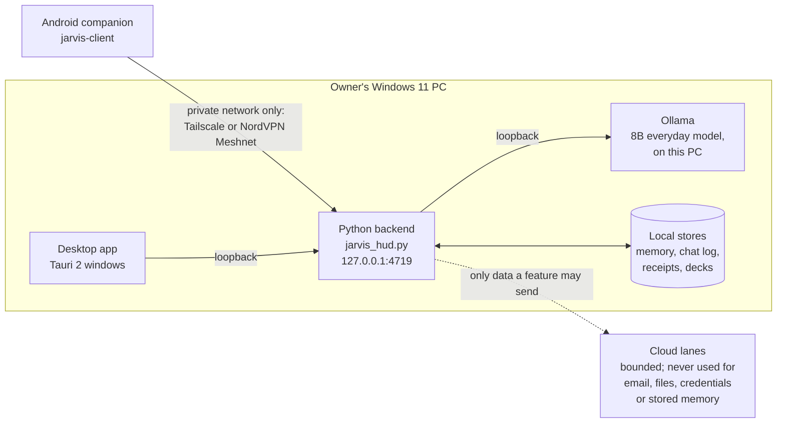
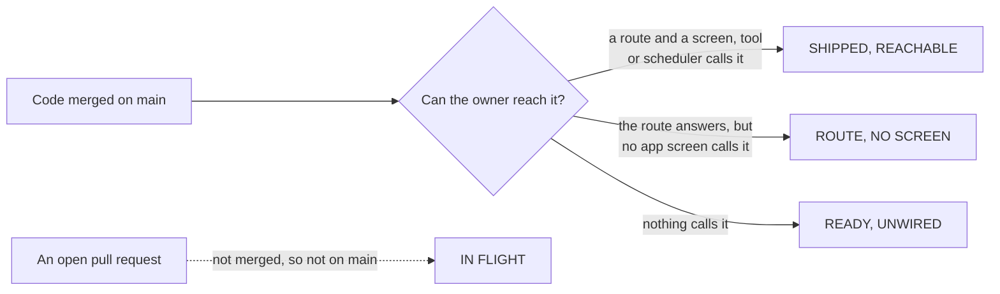
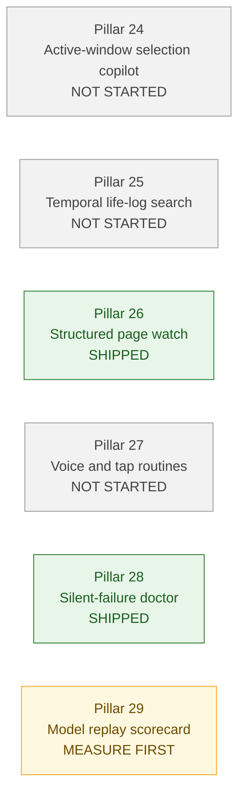

# What actually ships in Jarvis today

**A map of what is built, what the owner can reach, and what is still only a
library on a shelf.** This revision was refreshed against `origin/main` at
`b0f2c253` (2026-10-18); it was first written against `7ddb5b8c` (2026-10-17).
Every row names the file and line it came from, and the commands to re-run them
are in [the evidence appendix](#how-this-page-was-checked).

The short answer: most of what Jarvis does is built and reachable. A small,
named set of working modules has no caller. Two Volume III pillars moved from
in flight to shipped at this revision (both extend routes the apps already
use), one is "measure first", and three have no code at all. Ten pull
requests are open and none of them is on `main`.

This page describes the repository tree, **not** the copy of the backend that
runs on the owner's PC. That copy lives outside this repository
(`docs/ARCHITECTURE.md` §9, line 2570) and can be behind it.

---

## How to read this page

The diagrams are written in Mermaid, a text format GitHub draws as a picture.
The raw text still reads in order if your reader does not draw it.

| Label | What it means | The evidence every row gives |
|---|---|---|
| **SHIPPED, REACHABLE** | On `main`, and a route, tool or app screen calls it today. | A call site in this repository, as `file:line`. |
| **ROUTE, NO SCREEN** | The server answers the request, but neither app has a screen or button for it yet. | The route, and the architecture page saying no app calls it. |
| **READY, UNWIRED** | On `main` and tested, and nothing calls it. | The module's own words, and a grep that finds only the module and its test. |
| **IN FLIGHT** | An open pull request. Not merged, so not on `main`. | GitHub reports the PR open. |
| **NOT STARTED** | No code on `main`. Nothing is promised. | The file or symbol is absent from the tree. |
| **OFF / OWNER-GATED** | Built and wired, but switched off until the owner turns it on, or waiting for the owner's decision. | The switch's own default, or the design that says so. |

What this page deliberately does **not** claim:

- that the owner's installed backend equals this tree;
- that an open pull request is finished, tested, or safe to merge;
- that "not started" will stay that way;
- that "reachable" means good. It only means something calls it.

---

## 1. The whole thing in one picture



Plain words: the phone talks over a private device-to-device network to a Python
HTTP server on the owner's PC, and the desktop talks to that same server on the
loopback address. The server asks a local model for the thinking and reads local
stores for facts, chat history and receipts.

- **The desktop app** is a Tauri 2 shell: a Rust program that wraps web pages.
  Its source folder holds 188 files and its capability folder lists 11
  windows/permission sets (`jarvis-desktop/src-tauri/capabilities/`).
  `docs/ARCHITECTURE.md` §8 (line 1957) describes the windows.
- **The phone app** is `jarvis-client` (Android, Jetpack Compose), with 92 files
  in its screens folder (`jarvis-client/app/src/main/java/com/jarvis/client/ui/screens/`).
- **The server** is `jarvis_hud.py`. The repo publishes a copy as
  `jarvis-backend/jarvis_hud.py`; the owner's own copy is the one that runs.
  The usual port is 4719 (`README.md:131`).
- **The model** runs in Ollama on the same machine: "an 8B model in Ollama on
  the same machine" (`CLAUDE.md:68-71`, the project description). The everyday
  8B chat is pinned to one card for now (`docs/MODEL-TOPOLOGY.md:555`). Both
  cards are installed and measured (`docs/MODEL-TOPOLOGY.md:7-9`).
- **What never leaves the PC:** "Anything touching email, files, credentials or
  stored memory stays on the local model" (`CLAUDE.md:103-104`;
  `docs/ARCHITECTURE.md:33`, invariant 1). The one named exception is the
  encrypted backup file the owner may place in a folder a cloud-sync program
  uploads (`docs/ARCHITECTURE.md` §2).
- **No public tunnel:** the app may be reached over Tailscale or NordVPN
  Meshnet, both private device-to-device networks, and "never a public tunnel"
  (`CLAUDE.md:68-71`; the rule itself is `CLAUDE.md:105-106`).
- **A detail that is easy to miss:** the local model counts as "outside" if the
  program is told to use an address that is not this PC
  (`docs/ARCHITECTURE.md:1038`). "Local" is a checked property, not a promise.

---

## 2. Three kinds of "built"

The architecture page opens with the project's worst recurring defect:
*"capability with no call site"* (`docs/ARCHITECTURE.md:7`). This diagram is the
lens for the rest of the page.



"Wired" in this page means exactly one thing: **a call site was found**. A
module that is registered as shipped is not called wired. A route that exists is
not called wired to an app until an app file names it.

---

## 3. Shipped and reachable: the map

These are the capabilities where a real client path was found. The API page
documents each call site it knows about in `docs/JARVIS-API.md`; the lines below
are the ones checked for this page.

| What the owner can do | Client evidence (phone / desktop) | What answers on the PC | Label |
|---|---|---|---|
| Chat with the local model, with tools | phone `net/JarvisApi.kt:3643`; desktop `commands.rs:2581`, `hud_proxy.rs:269` | `POST /api/chat` at `jarvis-backend/jarvis_hud.py:4447`; 32 tools in `backend/jarvis_agent.py:1799` (8 core at `:5287`; the read-only `run_data_script` sandbox tool is at `:1821`) | **SHIPPED, REACHABLE** |
| Answer approval cards | phone `net/GateHistory.kt:13`; desktop `hud_proxy.rs:36` | `/api/pending` at `jarvis_hud.py:3231`; approve/deny at `:4416` | **SHIPPED, REACHABLE** |
| Memory and the Brain | phone `ui/screens/BrainScreen.kt:201`; desktop `brain/routes.rs:51` | `jarvis_hud.py:3072` and `:3206`; facts in base-only `jarvis-backend/jarvis_memory.py` (§9) | **SHIPPED, REACHABLE** |
| Talk to Jarvis and hear it | phone `net/JarvisApi.kt:3366` | `jarvis_hud.py:3321`; voice modules ship whole | **SHIPPED, REACHABLE** |
| Review study decks | phone `JarvisRuntime.kt:6655`; desktop `brain/decks.rs:10` and `src/decks.js:144` | `backend/jarvis_decks.py:1351-1352` | **SHIPPED, REACHABLE** |
| Ask the PC doctor for help | phone `net/PcHelp.kt:14`; desktop `hardware.rs:18` | `backend/jarvis_pc_help.py:93`, installed by `jarvis_brain_reads.py:70` | **SHIPPED, REACHABLE** |
| Spending summaries | phone `JarvisRuntime.kt:5429`; desktop `spending.rs:23` | `backend/jarvis_spending.py:102` | **SHIPPED, REACHABLE** |
| Goals and their steps | phone `JarvisRuntime.kt:5981`; desktop `brain/goals.rs:7` | `backend/jarvis_goals.py:936` | **SHIPPED, REACHABLE** |
| Projects | phone `net/Projects.kt:21`; desktop `brain/projects.rs:15` | `backend/jarvis_projects.py:2736` | **SHIPPED, REACHABLE** |
| Backups and restore | phone `net/Backup.kt:33`; desktop `backup.rs:10` | `backend/jarvis_backup.py:330` | **SHIPPED, REACHABLE** |
| Pair a phone | phone `net/Pairing.kt:39`; desktop `devices.rs:16` | `backend/jarvis_devices.py:2481` | **SHIPPED, REACHABLE** |
| Page watches | phone `net/Watch.kt:19`; desktop `brain/routes.rs:47` | `jarvis_hud.py:2359`; topics in shipped `jarvis_tellme.py` | **SHIPPED, REACHABLE** |
| Turn on second-card features | phone `net/SecondCard.kt:37`; desktop `commands.rs:4099` | `backend/jarvis_second_card.py:643` (7 features) | **OFF / OWNER-GATED** |

Routes and section numbers in `docs/JARVIS-API.md`: chat §4 (line 390),
approvals §3 (line 222), memory §6 (line 1214), voice §5 (line 967), decks §102
(line 16898), PC help §84 (line 13586), spending §100 (line 16524), goals §59
(line 10338), projects §88 (line 14842), backups §45 (line 8710), pairing §90
(line 15154), watches §70 (line 12010), second card §108 (line 17468).

**The numbers this map rests on** (all measured; commands in the appendix):

- **206 entries** in the shipped list `backend/_where.py`, of which **10** are
  the rebuilt modules the base also carries.
- **315** patch files under `backend/`; **214** `.py` files in
  `jarvis-backend/`.
- `docs/JARVIS-API.md` has **135** top-level sections, and **855** lines that
  mention an `/api/` path.
- The phone's Java source has **270** lines that mention an `/api/` path; the
  desktop Rust source has **400**; the desktop web source has **195**. These are
  **lines that mention a path, not a count of calls.** (This refresh did not
  re-derive the method behind these three counts and leaves them as the first
  revision had them; re-run a count before relying on them. Every other number
  here was re-measured at `b0f2c253`.)
- `jarvis_agent.py` offers **32** tools; the optional short list keeps **8**
  core tools in front of the model.

---

## 4. Ready, not wired: the shelf

Six shipped modules have no production caller today. The guide that ordered
this page calls this the "shipped library with zero callers" queue. Two of the
original seven were wired by pull requests that are now merged (#543 wired the
sandbox, #544 wired the guardian); one merged module joined the shelf (#538,
the decision lab); and two of the six are being wired right now by open pull
requests (#549, #556), which are **not** on `main` (section 6).

| Shelf item | What it can do, in plain words | Called today | What wiring would unlock |
|---|---|---|---|
| `jarvis_self_improve.py` | Reads Jarvis's own source, answers a question with real `file:line` citations, and drafts a fix; it applies nothing. | Nothing. "No route, and no client of any kind" (`backend/jarvis_self_improve.py:89`, `:113`). | A self-diagnosis the owner can ask for from an app, with an evidence trail. **Open PR #549** adds two read-only diagnostic routes. |
| `jarvis_ollama_contract.py` | Asks the local model what it can do, then reports where Jarvis's picture of the model is wrong. It reads no version number. | Nothing. "Has no call site yet" (`scripts/apply-patches.ps1:1915`); no route (`backend/jarvis_ollama_contract.py:90`). | A PC-help row that says "Jarvis is under-using this model" instead of guessing. |
| `jarvis_tool_schema.py` | Checks a JSON schema before it is sent to Ollama as a tool or format contract, and refuses a malformed one in plain words. | Nothing. "It has NO CALLER YET" (`scripts/apply-patches.ps1:1911`); no import outside its own test. | Safer tool calls: a bad schema is refused before the model sees it. **Open PR #556** wires this. |
| `jarvis_hf_inspect.py` | Reads a Hugging Face repository's file listing **before** a download: what is in it, sizes, quant labels, missing pieces, and the cache a hybrid model really grows. | Only its own command line (`backend/jarvis_hf_inspect.py:399`). "No call site yet" (`apply-patches.ps1:1917`). | A warning before the owner downloads the wrong or over-large model. |
| `jarvis_decision_lab.py` | A red-team pre-mortem of one decision: the case against it, failure modes with likelihood and impact, and a deterministic 1-3-1 recommendation - no cloud lane and no second model pass. | Nothing. "This is the BACKEND SLICE, deliberately unwired: there is no route" (`backend/jarvis_decision_lab.py:95`); no import outside its own test. | A pre-mortem the owner can ask for from chat or an app before saying yes to something. |
| `jarvis_task_lease.py` | A lease: a time-limited permission slip that names one surface, the sites or windows it may touch, the actions, a time limit and a step budget, checked step by step. | **Consumer side only.** `jarvis_browser_control.py` imports it at its one integration point (`:3277`) and checks each step (`:3345`); no production caller ever opens one - `create()` is called only by its test (`apply-patches.ps1:1913`). | A bounded browser run that does not raise one approval card per step. |

One more shelf item has no route at all, even though its module is reachable:

- **The decks voice-review slice, merged at `7ddb5b8c`.** The commit changed
  three files only: `backend/jarvis_decks.py`, `backend/test_decks.py` and
  `jarvis-backend/jarvis_decks.py`. It added `grade_spoken_answer()`
  (`backend/jarvis_decks.py:297`), `low_retrievability_topics()` (`:383`),
  `record_voice_review()` (`:1156`) and a tool name, `decks.voice_review`
  (`:251`). Nothing outside the module and its test names them, and no route
  or app file was in the commit. Status: **READY, UNWIRED.** An open PR (#550)
  would wire it to the phone's review screen.

One correction to the guide this page was built from: it says "6 unwired
`$SHIPPED` modules", but the rows it lists name **seven** modules (one row pairs
`jarvis_self_improve` with `jarvis_ollama_contract`), and the first revision of
this page measured seven. At `b0f2c253` the measurement is **six**: #543 and
#544 took two modules off the shelf, and #538 put one on it.

**What left the shelf at this revision.** #543 made the Python sandbox a
read-only chat tool, `run_data_script` (`backend/jarvis_agent.py:1821`), so the
chat row in section 3 reaches it from both apps. #544 made the guardian take a
snapshot before approved writes: the Obsidian vault's write
(`backend/jarvis_notes.py:255`) and Project Mode's pointer-file replace
(`backend/jarvis_projects.py:2223`). The guardian still has no restore route and
no chat tool - only its snapshots are wired, so putting a snapshot back stays
unreachable. Its own docstring still says "It has no route, no chat tool and no
call site yet" (`backend/jarvis_file_guardian.py:123`), which those two imports
now contradict; the registration comment in `backend/_where.py` records the
consumer-side wiring instead.

---

## 5. Built on the server, no screen yet

These are routes the PC answers today, where the architecture page says no app
screen calls them. They are not "unwired" - the server half is done - but the
owner cannot reach them from either app.

| Capability | Route evidence | The architecture page's own words |
|---|---|---|
| Action receipts, with one-click undo | `GET /api/receipts`, `POST /api/receipts/<id>/undo` at `backend/jarvis_receipts.py:206-207` | "The store and its two routes are built... What neither app has yet is a screen" (`docs/ARCHITECTURE.md:2256` onward) |
| The skill library's other doors | `backend/jarvis_skill_hub.py:152-153` serves `/api/skills/hub/references`, `/api/skills/hub/projects` and `/api/skills/hub/lock`, plus `/api/skills/chain` and `/api/skills/learn` | "No screen calls any of them yet" (`docs/ARCHITECTURE.md:2566`) |
| The job list | `jarvis-backend/jarvis_hud.py:2377` and `:2396` | The API page's own heading says "backend module and its route built, both apps not yet" (`docs/JARVIS-API.md:18171`) |

The architecture page's §8 also has an "One-sided on purpose" list (line 2249):
places where the two apps deliberately differ, each with its reason. A missing
feature on one app is not automatically an oversight - check that list first.

---

## 6. In flight: open pull requests are not shipped

Ten pull requests are open against `main` (checked with `gh pr list` on
2026-10-18), numbered **#536, #540, #546, #549, #550 and #552-#556**. **#537 is
not in this list: it merged at `7ddb5b8c`.** Neither are the ten PRs that
merged between the page's first revision and this one: #538 (decision lab,
`df01bd0c`), #539 (README, `74eca253`), #541 (page watch, `7d72b200`), #542
(handover, `76ee5abf`), #543 (sandbox tool, `cc76c022`), #544 (guardian hooks,
`d47b736e`), #545 (PC doctor, `2146ae65`), #547 (this page, `ca244558`), #548
(clipboard desktop half, `8ba40950`) and #551 (hybrid-model VRAM estimate,
`b0f2c253`). Nothing below is on `main`; each line is the PR's own title,
shortened.

| PR | Branch | What it adds, in one line |
|---|---|---|
| #536 | `feat/clipboard-time-machine-backend` | The backend half of the clipboard time machine (its desktop half merged at `8ba40950`). |
| #540 | `feat/personal-crm-and-pre-meeting-dossier` | A pre-meeting dossier from the owner's own local data (Pillar 16). |
| #546 | `feat/update-modes-with-eta` | Three update paces with honest ETAs and a progress bar. |
| #549 | `feat/self-improve-diagnostic-plugin` | Two read-only self-diagnosis routes, switched on by a drop-in folder. |
| #550 | `feat/phone-deck-review` | A fading-card radar on the phone, and a typed answer the PC marks (the decks voice-review wiring). |
| #552 | `fix/update-banner-after-install` | The cached "newer build" line ends when that build is installed. |
| #553 | `chore/deny-zbus-unmaintained-advisories` | Ignores the three unmaintained zbus advisories, with a reason. |
| #554 | `docs/refresh-what-ships-2026-10-18` | An in-flight revision of this page. |
| #555 | `feat/clipboard-in-feature-list` | Puts the clipboard time machine on the feature list, with its lesson. |
| #556 | `feat/tool-schema-sanitiser-wiring` | The tool-schema sanitiser on the way out, and validation on the way in. |

`gh` reported all ten as `MERGEABLE` at this revision. Mergeable is not the
same as tested or merged: the six required CI checks decide that, and they are
read on each PR's page, not here.

The merged pair #543 and #544 is the shelf work section 4 used to list: the
sandbox and the guardian are called by `main` now. The open wiring is **#549**
(self-improve's diagnostic routes), **#556** (the tool-schema guard) and
**#550** (the decks voice-review slice). #536 is the backend half of the
clipboard whose desktop half is on `main`; the desktop files add no `/api/`
call, so the bar they add does not depend on #536.

---

## 7. Volume III: Pillars 24-29

"Volume III" is the guide's name for six big capabilities. The picture first,
the evidence under it.



| Pillar | What it would be | Status | Evidence |
|---|---|---|---|
| 24 - Active-window selection copilot | Press a key, and Jarvis reads whatever text is highlighted in the window in front, after blocking password and banking apps. | **NOT STARTED** | No `jarvis_active_context.py` on `main`; `TextPattern` and `GetSelection` (the Windows pieces it needs) appear **zero** times in the tree; no open PR for it. |
| 25 - Unified temporal life-log search | "What did I work on, spend or decide last week?", answered read-only across the local stores. | **NOT STARTED** | No `jarvis_timeline.py` on `main`; no open PR. |
| 26 - Structured page watch | Page-change alerts that show the price, version or stock change without the page noise. | **SHIPPED, REACHABLE** | PR #541 merged at `7d72b200`. It extends the existing, reachable `jarvis_tellme.py` watch (route at `jarvis_hud.py:2359`) with `diff_watch_snapshot()` (`backend/jarvis_tellme.py:1972`), and the PR changed no app code - the change detail rides the page-watch line both apps already show. |
| 27 - Deterministic voice and tap routines | One spoken phrase or one tap runs a fixed chain of low-risk steps with one Undo receipt. | **NOT STARTED** | No `jarvis_routines.py` on `main`; no open PR. |
| 28 - Silent-failure doctor | Names four failures that look like nothing: a dead mic after sleep, a bloated database log, an unreachable phone, a wedged Ollama socket. | **SHIPPED, REACHABLE** | PR #545 merged at `2146ae65`. `diagnose_silent_failures()` (`backend/jarvis_pc_help.py:1165`) adds the four checks named in `SILENT_CHECKS` (`:164`: `digital_zero_mic`, `wal_bloat`, `phone_unreachable`, `ollama_wedged`) to the existing PC-help route (§84) both apps already use. The PR changed the shared contract fixtures, not app screen code. |
| 29 - Golden tool-call and contract replay | Replays a fixed set of real tool scenarios against a candidate local model and prints a pass/fail scorecard. | **MEASURE FIRST, NOT STARTED** | No replay module on `main`. `tools/model_tryout/chat_tryout.py` is the older model-tryout timer, not this suite; no open PR. The guide's rule is measure on this PC first, and if it does not win, record "not worth it" rather than build it. |

The same measure-first rule covers **Pillar 13, speculative decoding** (a small
draft model guesses tokens so the big one answers faster). It is a research idea
in this repository (`docs/FEATURE-REVIEW-2026-10-04.md:216`), not code: all ten
mentions of "speculative" in the tree are design pages, research notes or
explanatory comments, and none is an implementation of it.

---

## 8. Off by default, and waiting on the owner

Built is not the same as on. These are the deliberate "not yet" switches.

- **The second card's seven features are all off.** They are Longer
  conversations, Pictures, Learning in the background, Browser control, the Wiki
  builder, Study helper and Referee suggestions. The module says it plainly in
  its own words: "every feature built for it, ALL OFF, each behind a switch that
  can only be turned on once a capable second card is actually detected"
  (`backend/jarvis_second_card.py:1-11`), and the API page says both are "built
  switched off until that feature is measured" (`docs/JARVIS-API.md:17471`).
  `CLAUDE.md:77` says the second card is installed but its features are not
  measured. The switches are on both apps; the default is off.
- **Measure-first: Pillars 13 and 29.** Neither is built. The rule is to measure
  on the real PC first and to record "not worth it" if the measurement does not
  win. Do not read the research pages as a promise of a feature.
- **Pillar 12, the local scribe (meeting-style notes with speaker labels), is
  parked on the owner's privacy answers.** No code for it exists on `main`; the
  phrase "speaker diarization" (telling speakers apart) appears only in research
  notes (`docs/CUTTING-EDGE-2026-09-26-round3-knowledge.md:187`,
  `docs/creativity-2026-09-25/future.md:361`). The guide that ordered this page
  says it waits for the owner's explicit answer on three privacy questions
  before anything is written.
- **The decks voice-review slice is not owner-gated; it is just unwired.**
  Its backend functions merged at `7ddb5b8c` and no route or screen calls them
  (section 4). That is the ordinary "built beside the system" case, not a
  privacy decision. An open PR (#550) would wire it to the phone's review
  screen.
- **The clipboard time machine is opt-in, and only its desktop half is on
  `main`.** PR #548 merged at `8ba40950`: a RAM-only history of copied text in
  the desktop bar, forgotten on the next lock, added in desktop files that make
  no `/api/` call. The backend half is still the open PR #536.

---

## How this page was checked

**The tree asked.** Every claim about the code was asked of `origin/main` at
`b0f2c253`, by naming that revision in the command - not of a working checkout,
which can be on another branch. One checkout available while the first revision
was written reported itself 43 commits behind `origin/main` (`git status`); a
search there would have answered a different question.

The commands (run from any checkout of this repository, after `git fetch origin`):

| Question | Command |
|---|---|
| What is the revision? | `git ls-remote origin refs/heads/main` (gave `b0f2c253`) |
| What files exist on main? | `git ls-tree -r --name-only origin/main -- path` |
| What does a file say on main? | `git show origin/main:path` |
| Who mentions this name? | `git grep -n 'name' origin/main` (and `-l` for files only) |
| Is this PR open or merged? | `gh pr list --repo darknight11ish/Epic-Jarvis --state open --limit 60 --json number,title,headRefName,mergeable`; `gh pr list --state merged --limit 15 --json number,title,mergeCommit,mergedAt`; `gh pr view 537 --json state,mergeCommit` |
| What is in the shipped list? | `git show origin/main:backend/_where.py` (parsed with Python's `ast`) |
| What tools does the agent offer? | `git show origin/main:backend/jarvis_agent.py` (parsed with Python's `ast`) |
| Do the docs count and size agree? | `python -B tools/check_docs_map.py` |

Reproduce the shelf rows in one step each:

```powershell
git grep -n 'jarvis_self_improve' origin/main
git grep -n 'jarvis_ollama_contract' origin/main
git grep -n 'jarvis_tool_schema' origin/main
git grep -n 'jarvis_hf_inspect' origin/main
git grep -n 'jarvis_decision_lab' origin/main
git grep -n 'jarvis_task_lease' origin/main
```

Each result is the module, its twin, its test, and its registration lines in
`backend/_where.py` and `scripts/apply-patches.ps1` - except `jarvis_task_lease`,
whose consumer-side import in `jarvis_browser_control.py:3277` is the one extra
hit and is named in section 4. A zero-caller claim is a claim about this tree;
the installed backend's own copy is not read here.

**Nothing on this page is a check.** No test, checker or bite was added, so
there is no "bite proof" to show and none is claimed. What protects the page is
that each row names a file and line a reader can re-open. If a line drifts, the
symbol names still find it.

### Not verified here

- **The owner's installed backend.** This page reads the repository tree. Whether
  the live folder matches it is a separate measurement; the handover this page
  was written from says the live copy can be a few modules behind. Running
  `scripts/apply-patches.ps1` from a clean tree, then comparing every `*.py` in
  the live folder to `origin/main:jarvis-backend/`, would confirm it.
- **The pull requests' CI.** Only `gh`'s state, mergeability and titles were
  read - not the six required checks on any open PR, and not the merged
  commits' CI either. A merged commit is assumed green by the merge, not
  checked here. #554's diff was not read at all (it is an in-flight revision of
  this page).
- **Whether both apps display the new PC-doctor rows and the page-watch change
  detail.** PRs #545 and #541 changed backend payloads and the shared contract
  fixtures, not app screen code; the screens that already render those routes
  were not re-read here.
- **Whether the Mermaid diagrams draw on GitHub.** They were checked as text
  only. GitHub draws fenced `mermaid` blocks; the diagrams are also written so
  the node labels read in order without rendering.
- **Whether the new second card's features have since been measured.** The
  repository says all seven are off; a measurement on the PC is what would
  change that, and it is not in this repository.
- **Whether any live backend copy calls the deck voice-review functions.** The
  zero-caller finding is about `origin/main`; the owner's folder is outside it.

Cross-references: [ARCHITECTURE.md](ARCHITECTURE.md) (rules and invariants),
[JARVIS-API.md](JARVIS-API.md) (every route and its call sites),
[MODEL-TOPOLOGY.md](MODEL-TOPOLOGY.md) (what runs on the cards), and
[../CLAUDE.md](../CLAUDE.md) (the five non-negotiables).
